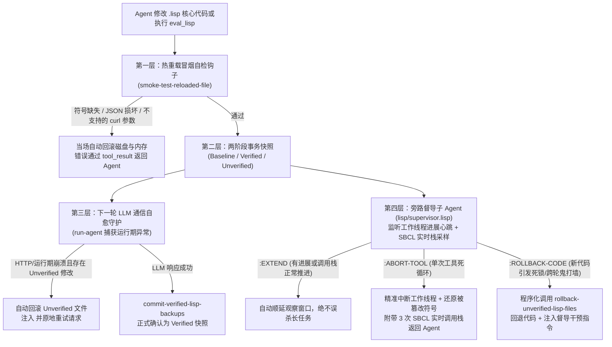

# λ MyAgent (Common Lisp Edition)

基于原生 **Common Lisp (SBCL)** 构建的本地文件管理与实时自我演化 Agent。

零第三方库依赖（仅依赖 SBCL 与系统 `curl`），利用 Lisp 的 **同像性 (Homoiconicity)** 与运行时热编译（`load` / `eval`），实现**在对话过程中直接修改或扩展核心功能，即刻生效，无需重启进程或执行任何构建脚本**。

---

## 主要特性

- **开箱即用**：项目内置 SBCL 运行时（`bin/`），无需安装任何依赖
- **免重启自迭代与四层防失联自愈**：修改 `.lisp` 即热重载；内置**冒烟自检 + 两阶段事务快照 + 运行期崩溃自动回滚 + 旁路督导子 Agent (`supervisor.lisp`)**，即使改坏底层通信或写出死循环也能自动回退自愈，任务不中断
- **旁路督导子 Agent（防死循环 & 防误杀）**：摒弃「固定超时一刀切」，通过**进展心跳监测 + SBCL 非侵入式实时调用栈采样（`list-backtrace`）+ 轻量 SubAgent 裁决**，自动区分「正常耗时任务（`:EXTEND` 顺延）」、「单次工具死循环（`:ABORT-TOOL` 精准中断）」与「热重载代码死锁（`:ROLLBACK-CODE` 程序化回退）」
- **影子克隆自迭代（默认开启，面向 24 小时无人值守）**：改动先落在 `.myagent/shadow/` 轻量克隆里，必须同时通过「改动文件编译 + 独立 SBCL 进程全量加载」双重验证，且主进程空闲时才合并；合并失败自动用原始内容回滚，用户中途退出直接丢弃克隆。严格门禁包含保护文件名单、改动大小上限、危险调用拦截与小时/天配额；强度三档由 `/self intensity low|medium|high` 控制（默认高档：安静 10 秒即触发、间隔 120 秒）
- **安全写入与崩溃恢复**：所有写文件走「备份 → 临时文件 → 原子替换」，并留下 `pending-edit` 恢复日志；启动时若发现日志未清理，自动用备份还原，避免窗口被强行关闭时留下半截源码导致下次启动失败
- **空闲自监管迭代子 Agent（`lisp/self-iteration.lisp`）**：用户长时间无操作时，后台线程按「空闲 8 分钟触发、两次自省最低间隔 30 分钟、单会话上限 6 次」的低频率做一次轻量自省，分析可迭代优化项并静默写入 `notes/self-iteration-log.md` 与待办清单 `notes/self-iteration-backlog.md`；用户下次回到提示符时给出一行「发现了什么 / 更新了什么」提示。默认只分析、不自动改代码，可用 `/self [status|on|off|run|log|backlog]` 查看与控制，环境变量 `MYAGENT_SELF_ITERATION=0` 可关闭；底部状态栏（缓存命中 / 上下文占比那一行）最右侧打印状态灯：红=关闭、黄=等待、绿=执行。它随状态栏一次性静态打印，不对输入行做任何光标操作，避免干扰用户输入回显。
- **终端 Markdown 渲染**：标题 / 列表 / 代码块 / **表格等宽对齐**（中文按 2 列宽）/ 长单元格自动折行；**流式输出的正文同样逐行渲染**（普通行即时渲染，表格整块对齐后再输出），不会先冒出一段原始 Markdown
- **24-bit 半块高精度 CLI 像素画**：启动横幅并排绘制经典 **《玲音》岩仓玲音黑白剪影肖像 (Iwakura Lain)** 与 **DeepSeek 官方蓝鲸** 26×28 半块像素图标，自动适配深浅色终端背景
- **彩色提示**：统一用 `[成功]` / `[失败]` / `[警告]` / `[提示]` 彩色标签代替 emoji，`/color` 可开关
- **终端友好**：emoji 与键帽数字自动转成文本标签，避免乱码
- **持久化记忆**：Markdown 文件存储，跨会话保留，目录随项目走
- **上下文瘦身**：工具调用链按 head + omit + tail 压缩，配合 DeepSeek 前缀缓存，每轮打印缓存命中率
- **跨平台**：Windows（`start.bat`）/ Linux、macOS（`start.sh`）

---

## 项目结构

```text
├── run.lisp                 # SBCL 启动与模块引导入口
├── start.bat                # Windows 启动脚本（优先使用 bin/ 内置运行时）
├── start.sh                 # Linux / macOS 启动脚本
├── .env.example             # 环境变量示例
├── bin/                     # 内置 SBCL 运行时（sbcl(.exe) + sbcl.core + contrib/）
│   └── README.md            # 运行时获取方式与许可说明
├── memory/                  # 持久化记忆（默认不纳入版本控制）
└── lisp/
    ├── reload-engine.lisp   # 安全热重载引擎（三级快照 / 冒烟自检 / 两阶段事务回滚）
    ├── json.lisp            # 纯 Common Lisp RFC 8259 JSON 解析与序列化
    ├── config.lisp          # .env / 配置加载与 DeepSeek 配置解析
    ├── ui.lisp              # 终端 ANSI 颜色与语义标签渲染
    ├── file-utils.lisp      # 文件读写、搜索、移动、删除 + 路径工具
    ├── markdown.lisp        # 终端 Markdown 渲染（表格对齐 / emoji 转标签）
    ├── llm-client.lisp      # DeepSeek LLM 客户端（Anthropic Messages 兼容 + SSE 流式输出）
    ├── cancel.lisp          # 后台工作线程调度 + ESC 实时中断轮询
    ├── supervisor.lisp      # 旁路督导子 Agent（心跳监测 / 实时栈采样 / 死循环程序化决策回退）
├── self-iteration.lisp  # 空闲自监管迭代子 Agent（低频率自省 / 发现提示 / 建议清单）
    ├── tools.lisp           # 动态工具注册表 + 内置工具与 eval_lisp 防篡改沙箱
    ├── agent-loop.lisp      # ReAct Agent 主循环（含运行期通信异常自动回滚重试）
    ├── context-manager.lisp # 上下文压缩（head+omit+tail）+ 缓存命中观测
    └── cli.lisp             # 控制台交互式 REPL（裸模式行编辑器 + 粘贴折叠 + 半块像素画）
```

---

## 快速开始

### 方式 A：使用内置运行时（推荐，零安装）

```powershell
.\start.bat            # Windows
```

```bash
chmod +x start.sh && ./start.sh   # Linux / macOS（需把对应平台运行时放入 bin/）
```

启动脚本会**优先使用 `bin/` 里的 SBCL**，并自动设置 `SBCL_HOME`。

> `bin/` 默认不随仓库分发（约 48 MB 二进制）。获取方式见 [`bin/README.md`](bin/README.md)：
> 把本机 SBCL 安装目录下的 `sbcl(.exe)`、`sbcl.core`、`contrib/` 复制进去即可。

### 方式 B：使用系统已安装的 SBCL

```bash
# macOS
brew install sbcl
# Debian/Ubuntu
sudo apt install sbcl
# Windows
scoop install sbcl    # 或 choco install sbcl
```

然后启动（脚本会自动探测 PATH 与常见安装位置）：

```powershell
.\start.bat
```

```bash
./start.sh
```

也可以直接用 SBCL 启动：

```bash
sbcl --noinform --load run.lisp
```

### 配置 DeepSeek API Key

进入控制台后：

- `/model` —— 交互式向导，填入 API Key（默认模型 `deepseek-flash`），自动保存
- `/model sk-xxxx` —— 单行快捷配置

Key 保存在 `~/.myagent/config`（**不在项目目录内，不会被提交**）。

---

## 数据与配置位置

| 内容 | 默认位置 | 是否入库 | 覆盖用环境变量 |
|---|---|---|---|
| 持久化记忆 | `<项目根>/memory/*.md` | 否（`.gitignore` 已排除） | `MYAGENT_MEMORY_DIR` |
| API Key 配置 | `~/.myagent/config` | 否 | `MYAGENT_CONFIG` |
| 本地环境变量 | `<项目根>/.env` | 否 | — |
| 内置运行时 | `<项目根>/bin/` | 否（二进制） | `MYAGENT_SBCL` |
| 项目根目录 | 自动检测（`run.lisp` 所在目录） | — | `MYAGENT_ROOT` |

> 开源仓库不包含任何个人记忆、密钥与二进制运行时。克隆下来即为空记忆状态，首次运行自动创建 `memory/`。

---

## 环境变量

| 变量 | 作用 |
|---|---|
| `DEEPSEEK_API_KEY` | DeepSeek API Key（也可用 `/model` 写入配置文件） |
| `DEEPSEEK_MODEL` | 模型名，默认 `deepseek-flash` |
| `DEEPSEEK_BASE_URL` | 接口地址，默认 `https://api.deepseek.com/anthropic` |
| `MYAGENT_SBCL` | 指定 SBCL 可执行文件路径（优先级低于 `bin/`） |
| `MYAGENT_ROOT` | 覆盖项目根目录 |
| `MYAGENT_MEMORY_DIR` | 覆盖记忆目录 |
| `MYAGENT_CONFIG` | 覆盖配置文件路径 |
| `MYAGENT_CURL` | 覆盖 curl 可执行文件名 |
| `NO_COLOR` | 禁用 ANSI 颜色输出 |
| `MYAGENT_CONTEXT_WINDOW` | 覆盖状态栏的模型上下文上限（tokens），默认取官方 `/models` 的 `context_window` |
| `MYAGENT_COMPACT_CHARS` | 覆盖消息级压缩阈值（字符，默认 800000） |
| `MYAGENT_MAX_TOKENS` | 覆盖单次响应的 max_tokens（默认 65536，模型上限 393216） |

---

## 免重启实时自我迭代与四层防失联自愈架构

MyAgent 全部核心逻辑运行在单个常驻 SBCL 进程镜像中：
1. **写入即热重载**：`write_file` / `append_file` 写入 `.lisp` 后立即 `load` 进当前镜像；
2. **内存直接求值**：`eval_lisp` 可执行任意 S-表达式，第 $N$ 轮注册的工具在第 $N+1$ 轮即可调用；
3. **手动重载与回滚**：支持 `/reload`（或 `reload_lisp` 工具）以及 `/rollback [baseline]` 紧急回退。

在自我迭代场景下，单纯拦截「编译期语法错误」是不够的——如果 Agent 改坏了底层 HTTP 通信参数（编译通过但运行期报 `curl exit 2`），或在 `eval_lisp` 中写出无限死循环，就会导致 Agent **「大脑失联」或「主线程死锁」**。为此系统构建了完整的 **四层运行期自愈防线**：



### 1. 第一层：热重载「冒烟自检钩子」（Post-Load Smoke Test）
每次热重载关键模块（`llm-client.lisp`、`json.lisp`、`agent-loop.lisp`、`tools.lisp`）后，在 `load` 阶段内立即运行轻量级自检（[`smoke-test-reloaded-file`](lisp/reload-engine.lisp)）：
- 检查核心入口函数符号是否仍为 `fboundp`；
- 验证 `json-encode` / `json-decode` 往返闭环；
- 探测系统 `curl` 的 `libcurl` 编译特性（[`curl-supports-compressed-p`](lisp/reload-engine.lisp)），拦截当前系统不支持的命令行参数（如 Windows 自带无 `libz` 的 `curl.exe` 传入 `--compressed`）。一旦自检不过，在 `write_file` 当场回滚并报错。

### 2. 第二层：两阶段事务快照（Two-Phase Snapshot）
在 [`lisp/reload-engine.lisp`](lisp/reload-engine.lisp) 中维护三级源码快照，杜绝「新代码刚编译通过就把唯一好备份覆盖掉」的问题：
- `*lisp-baseline-backups*`：进程启动时的**黄金基线快照**（永不覆盖，可通过 `/rollback baseline` 一键恢复）；
- `*lisp-file-backups*`：当前已加载版本快照；
- `*lisp-unverified-backups*`：本轮热重载过、但**尚未经过下一轮 LLM 通信验证**的改动前快照。只有当下一轮 `chat-with-tools` 真正成功返回后，才调用 [`commit-verified-lisp-backups`](lisp/reload-engine.lisp) 确认提交。

### 3. 第三层：LLM 通信崩溃时的「运行期自动回滚 + 原地重试」
若某次修改绕过了冒烟测试，但在下一轮调用 `chat-with-tools` 时触发运行期异常（[`lisp/agent-loop.lisp`](lisp/agent-loop.lisp)）：
- 系统检测到存在未验证修改（`unverified-lisp-backups-p`）时，自动调用 [`rollback-unverified-lisp-files`](lisp/reload-engine.lisp) 将磁盘文件与内存定义恢复到改动前版本；
- 将刚发生的运行期异常写入 `<system-reminder>` 注入消息流，并在**同一轮内自动重试一次 LLM 请求**，实现「改坏大脑也能自愈、对话不中断」。

### 4. 第四层：旁路督导子 Agent 与死循环程序化决策回退（`lisp/supervisor.lisp`）
所有工具调用与 `eval_lisp` 均在独立后台工作线程（`myagent-tool-worker`）中运行，主线程每 50ms 轮询 `ESC` 中断，并由旁路 **Supervisor（督导器）** 实时监听，彻底取代僵化的「固定秒数一刀切超时」：
- **进展心跳豁免（防误杀）**：实时监测 `eval_lisp` 的 `stdout` 输出流增长、顶层 S-表达式推进与目录/文件读写心跳（`note-worker-progress`）。只要任务有进展，计时器自动清零，绝不误杀合法长任务。
- **非侵入式 SBCL 实时调用栈采样**：当工作线程连续 `6 秒`（`*supervisor-soft-stall-seconds*`）无进展时，督导器每隔 `2 秒` 通过 `sb-thread:interrupt-thread` + `sb-debug:list-backtrace` 对工作线程采集 3 次非破坏性调用栈快照（[`sample-worker-backtrace`](lisp/supervisor.lisp)）。
- **程序化规则 + 轻量 LLM SubAgent 三态裁决（[`supervisor-decide-action`](lisp/supervisor.lisp)）**：
  - **`:EXTEND`（顺延等待）**：若调用栈仍在正常变化推进，或督导子 Agent 判定为合理耗时计算，自动顺延观察窗口；
  - **`:ABORT-TOOL`（精准中断单次死循环）**：若调用栈冻结在控制台输入等待（如 `READ-CONSOLE-LINE`）或同一循环帧，立即打断该工作线程、通过 `unwind-protect` 自动还原被临时 mock 的底层控制台函数（[`*protected-console-fns*`](lisp/tools.lisp)），并将 **3 次实时 SBCL 调用栈**作为 `tool_result` 返回给主 Agent；
  - **`:ROLLBACK-CODE`（程序化代码回退）**：若死循环发生时存在尚未验证的热重载修改（`*lisp-unverified-backups*`），督导器直接程序化执行 `rollback-unverified-lisp-files` 回退磁盘与内存代码，再将回退报告与调用栈交还主 Agent。
- **跨轮次「鬼打墙」死循环拦截**：记录每轮工具调用签名（[`record-turn-tool-signature`](lisp/supervisor.lisp)），若主 Agent 连续 3 轮以几乎相同的参数重复调用同一工具原地打转，自动回滚未验证修改并注入 `<supervisor-intervention>` 强制干预指令。

> 默认**不会**每轮自动扫描磁盘上的 `.lisp`（避免任务中途被外部改动打断）。
> 需要时把 `*auto-reload-before-turn*` 设为 `t`。

---

## 上下文压缩与 DeepSeek 缓存优化

工具调用链不再整段堆进上下文，改为 head + omit + tail（主流 micro-compaction 做法）：

- **单条工具结果，写入即定型**：<= 16000 字符原样保留；<= 40000 字符保留前 8000 + 后 2000；更长保留前 4000 + 后 1200，中段替换为「已省略 N 行 / M 字符」标记，并提示模型按需重读。无换行的单行大文本（压缩 JSON / base64）自动降级为硬字符切分。
- **消息级压缩**（默认超过 800000 字符触发，约 30 万 tokens）：头部 3 条 + 尾部 12 条原样保留，中段折叠为一条结构化摘要（工具名 + 参数 + 结果规模）；切割点自动对齐，绝不拆散 `tool_use` / `tool_result` 配对，相邻同 role 消息自动合并。

针对 DeepSeek 前缀缓存（Context Caching）的专属优化：

1. System Prompt 静态，易变内容（环境、日期、热重载告警）只追加在消息尾部；
2. 工具结果在写入历史时就裁剪并定型，历史严格**追加式**，后续每轮前缀完全一致；
3. 压缩是惰性的**一次性前缀重写**（1.3x 滞后阈值），避免每轮改写前缀造成缓存全失效；
4. 省略标记幂等，同一内容不会被二次裁剪而产生新文本；
5. 每轮打印 `缓存命中 2.9K/3.7K (79%)`，兼容 `cache_read_input_tokens` 与 `prompt_cache_hit_tokens`，实时验证命中效果。

### 底部状态栏：按当前模型统计上下文占用（只统计，不做限制）

```
本轮缓存命中 98% (834K/850K)  ·  deepseek-flash 上下文 3% (27K/1.0M)  ·  会话均 100%
```

- 分母是**当前生效模型**的最大上下文：优先用官方 `/models` 返回的 `context_window`（缓存 1 小时，`deepseek-flash` / `deepseek-v4-pro` = 1048576）；离线时退回 `*model-context-windows*` 静态表，仍可用 `MYAGENT_CONTEXT_WINDOW` 覆盖；
- 覆盖顺序：`.env` 的 `MYAGENT_CONTEXT_WINDOW` > 程序内 `*ctx-window-tokens*` > 模型表；
- 未收录的模型**不猜**，只显示 `上下文 27K tokens（上限未知）`；
- 这个数值**只用于展示**：压缩、截断、重试、轮数控制都不读取它，统计偏差不会引发误压缩或误限流；
- 消息级自动压缩仍由独立字符阈值 `*ctx-max-prompt-chars*`（默认 800000 字符 ≈ 30 万 tokens，占 1M 窗口约 30%）驱动，可用 `MYAGENT_COMPACT_CHARS` 覆盖，随时可用 `/compact` 手动触发。

可调参数集中在 `lisp/context-manager.lisp` 顶部。

### 多行粘贴

- 支持**一次粘贴整段多行文本**（代码块、报错日志、表格等）：整段收集成一条输入，不会被拆成 N 次提问。
- 输入层由程序自己接管回显（关闭行缓冲与回显，直接用 ReadConsoleInputW 读按键记录）：粘贴进来的字符**根本不回显**，只在提示符后留一行 `You > [粘贴 12 行 · 486 字符]`，按回车才发送。
  旧版「先让终端回显、再用 ANSI 擦掉」会和 conhost 的行编辑状态打架，擦掉的内容被重画回来，表现就是「粘贴的几行擦不掉、删不掉」；本版从根上避免了。
- 粘贴识别：含换行、一次涌入多个字符（`*paste-burst-chars*`，默认 40），或「输入队列仍有积压」都判定为粘贴；Ctrl+V / Shift+Insert 由程序直接读剪贴板；右键粘贴由 conhost 插入字符，同样会被识别。
- 终端会把一次大粘贴拆成多批注入（每批最多 256 条按键记录）。只要还在 `*paste-continuation-ms*`（默认 400ms）的续接窗口内、或输入队列里仍有积压，后续批次就继续并入同一段粘贴，整段折叠，不会出现「占位符前面漏一段、后面又漏一段」。
- 粘贴前已经输入的文字会**保留并显示在占位符前面**，粘贴后在占位符后面还能继续补写；回车时按「已输入正文 / 粘贴内容 / 补写文字」三段用换行拼接提交，不会粘成同一行。
- 一次新的多行粘贴如果接在未换行的内容后面，会自动补一个换行再拼接；同一次粘贴被终端拆成多批到达时不会插入多余换行。
- 粘贴文本里的换行只算内容，不会触发提交；提交时会自动去掉正文首尾多余的空行，编辑模式里多按的回车不会变成空的用户回显行。
- 逐字输入、中文输入法上屏（通常 2~10 字）不会被误判成粘贴，照常回显。
- 行内编辑：退格 = 删除最后一个字符（先删补写的字，再逐字删粘贴内容）；600ms 内**连按两次退格 = 整段删掉已粘贴内容**；Ctrl+退格 = 整段丢弃；Esc / Ctrl+U = 清空整行；回车 = 发送；Ctrl+Enter = 直接发送。提示文字（Esc 清除 · Ctrl+E 编辑 · Ctrl+Enter 发送）显示在输入行末尾。
- **Ctrl+E = 展开为多行编辑模式**：把粘贴内容（或已输入文本）整段展开显示，方向键 / Home / End 移动光标，退格和 Delete 任意删除，Enter 插入换行，Ctrl+Enter 直接发送。
- **Esc 退出编辑的折叠规则**：只把「单行模式下粘贴进来的区间」还原成占位符，手写内容、以及在编辑模式里改过的文字都保持展开；编辑模式里粘贴的文字按普通输入插入，永远不会变成占位符。
- 连续粘贴会**累加**而不是覆盖，标签会显示「N 段」，行数/字数同步增长。
- 已知限制：普通折叠视图里不支持左右移动光标（要移动请用 Ctrl+E 进入编辑模式）；Agent 正在输出时敲的字符不会即时回显（下一个提示符出现时一起显示）；`*cli-collapse-paste*` 设 nil 可关闭折叠。


## CLI 指令

| 指令 | 说明 |
|---|---|
| `/model` | 配置 DeepSeek API Key |
| `/tools` | 查看已注册工具 |
| `/compact` | 手动压缩历史：头部+尾部保留，中段折叠为结构化摘要 |
| `/reload` | 热重载全部核心模块 |
| `/rollback` | 手动回滚最近未验证的热重载代码修改 |
| `/rollback baseline` | 一键将所有核心模块恢复到进程启动时的黄金快照 |
| `/md on\|off` | 开关 Markdown 渲染 |
| `/color [on\|off\|auto]` | 开关 ANSI 颜色 |
| `/emoji [on\|off]` | 开关 emoji → 彩色标签转换 |
| `/clear` | 清空对话上下文 |
| `/help` | 帮助 |
| `/exit` | 退出 |
| `ESC` | Agent 执行中按 ESC 中断当前任务：已产生的对话上下文完整保留，可继续提问 |
| `,<s-expr>` 或 `/eval <s-expr>` | 直接求值 Common Lisp |

非交互用法：

```bash
sbcl --noinform --load run.lisp -- --prompt "你好"
sbcl --noinform --load run.lisp -- --eval-lisp "(+ 1 2)"
```

---

## 体积参考

| 项 | 大小 |
|---|---|
| SBCL 运行时（`bin/`） | 约 48 MB（`sbcl.core` 31 MB + `contrib/` 14.5 MB + 可执行文件 2.3 MB） |
| 项目源码 | 约 200 KB |
| 运行内存 | 启动约 40 MB，加载全部模块约 100 MB |
